# How VisionTouch works

This is the explainer for presenting the project. Every member of the team should be able to explain any stage from this page.

VisionTouch turns any projector into a touch board. A camera watches the projected picture. The software finds the user's hand and fingertip and turns them into touches.

Each stage below says what it does, why it is needed, which lecture it belongs to, its main parameter, and what happens if you change that parameter. The figures are made by `eval/figures.py` from data recorded on our own rig. The tables between `BEGIN` and `END` marks are filled in by `eval/fill_report.py`, so do not edit them by hand.

**Read this first: what our tests can and cannot show.** All hands in our tests so far are **synthetic**. We painted a hand shape (a black "shadow" or a skin-tinted "hand") into the projected picture and filmed it through the real projector and cameras. This tests the whole vision pipeline under real light, real lenses and real colour errors. It does **not** test real skin, real 3-D shadows, pinch detection on a real hand, or a person's body blocking the camera. The real-hand test (the Accuracy app) has not been run yet.

## Words used on this page

| Word | Meaning |
|---|---|
| Screen picture, screenshot | What the computer sends to the projector. We grab it with a screenshot many times per second. |
| Camera frame | One photo from the camera. |
| Working image | The part of the camera frame that shows the projected picture, at half resolution. All pixel processing happens here. |
| Homography | A 3×3 matrix that maps points on one flat plane to another flat plane seen in perspective. Here: camera pixels to screen pixels. |
| Predicted image | What the camera *should* see if nobody is in front of the screen. |
| Residual | How far each camera pixel is from its predicted value, in grey levels (0 to 255). |
| Mask | A binary image: 1 where something is in front of the screen, 0 elsewhere. |
| Blob | One connected group of 1-pixels in the mask. |
| False positive | A pixel or frame where we report a hand but there is none. |
| Recall | The fraction of real hand pixels (or hand frames) that we find. |

## The pipeline at a glance

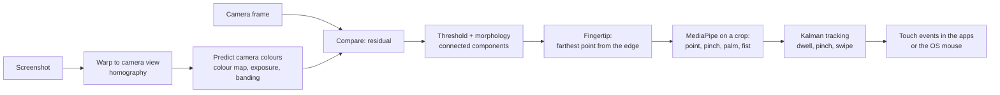

Calibration (stages 2 and 3) takes about ten seconds. It runs on first use, when the user presses "Calibrate", and by itself when the engine sees that the camera or projector has moved (most of the picture disagrees with the prediction for several seconds, or phase correlation between the predicted and observed images shows a steady shift). Everything else runs on every camera frame.

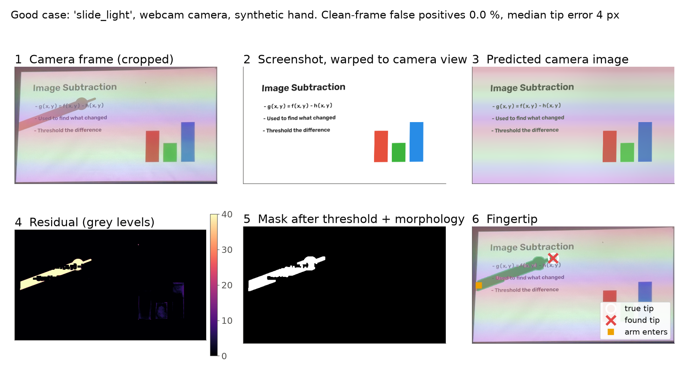

---

## 1. Capture

**What it does.** One thread reads the camera and keeps only the newest frame (`visiontouch/camera.py`). Another thread takes screenshots and keeps the last second of them at half size (`visiontouch/screen.py`). The camera can be a webcam, an iPhone through Continuity Camera, or an Android phone over USB.

**Why.** We must compare each camera frame with the picture that was on the screen *when the frame was taken*. The projector and camera add a delay, so the right screenshot is a little in the past. Calibration measures this delay by flashing the screen black then white and timing both.

**Lecture.** Digital image fundamentals: a colour image is three 2-D arrays (blue, green, red in OpenCV), each pixel 8 bits (0 to 255). Sampling and resolution: we work at half resolution.

**Main parameter.** The working resolution (`scale=0.5` in `Predictor`, `SCREEN_SCALE=0.5` for screenshots). Half resolution in both directions means a quarter of the pixels, so every later step is about four times faster. Going lower would make a finger only a few pixels wide and it would vanish in the morphology step. Going higher costs time and gains little, because the camera image is already blurred.

## 2. Geometric calibration (where is the picture?)

**What it does.** The projector shows a grid of 60 ArUco markers (black-and-white squares with a code inside, `calibrate.py`). OpenCV finds them in the camera frame and reads their numbers. Each marker gives 4 corners whose screen position we know, so we get up to 240 point pairs. `cv2.findHomography` fits one homography to them, using RANSAC (fit to random small subsets, keep the fit that most points agree with, so a few wrong detections do not matter).

**Why.** The camera sees the picture from an angle, as a skewed four-sided shape. The homography tells us, for every screen pixel, where it lands in the camera image, and back.

**Lecture.** Beyond the lectures. The nearest topic is image fundamentals (pixel coordinates). A homography is a perspective transformation: like scaling or rotation, but with 8 free numbers so it can model a tilted view of a flat surface.

**Main parameter.** The RANSAC distance (4 px) and the acceptance rule (at least 12 markers, error at most 6 px). A larger RANSAC distance accepts more points but lets bad ones bend the fit.

**Result.** The arrows show the error left at each marker corner, made 40 times longer so they are visible.

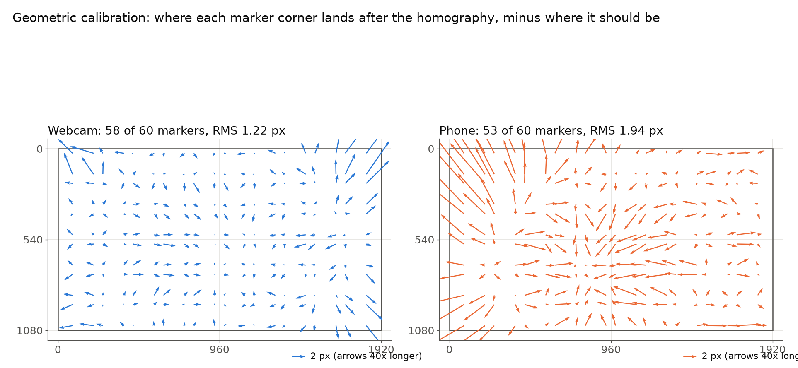

<!-- BEGIN calibration -->
| Camera | Markers found | RMS error (px) | Median corner error (px) | Worst corner (px) | RMS over 3 photos (px) | Same H on the other session's photo (px) |
|---|---|---|---|---|---|---|
| Webcam | 58 / 60 | 1.22 | 0.95 | 7.3 | 1.23, 1.22, 1.30 | 1.59 |
| Phone | 53 / 60 | 1.94 | 1.82 | 12.3 | 1.79, 1.94, 1.88 | 3.07 |
<!-- END calibration -->

## 3. Colour calibration (what colours does the camera see?)

**What it does.** The projector shows four mosaics of random colour tiles. Each camera photo is paired with a screenshot taken at the same time, so we know the screen colour of every tile (even if a notification covers part of it) and see the camera colour. We fit a **colour map**: for each camera channel, a cubic polynomial in the screen's blue, green and red (20 terms, `predict.py`). Tile borders are left out, and the fit ignores outliers.

**Why.** A projected white is not camera white. The projector, the screen surface and the camera each change colours and brightness, and not in a straight line. Without this map, plain subtraction flags almost every pixel (see the ablation below).

**Lecture.** Point processing and intensity transformations. A point transformation is `s = T(r)`: the output pixel depends only on the input pixel. The negative, log and gamma curves are fixed examples. Our colour map is a point transformation too, but learned from data and for three channels at once. Fitting it uses least-squares polynomial regression, which goes beyond the lectures.

**Main parameter.** The polynomial degree (3) and the pull towards a smooth map (`CALIBRATION_PULL`, ridge regression). A higher degree follows the calibration tiles more closely but can swing wildly for colours that were not in the tiles. A stronger pull gives a smoother, less exact map.

## 4. Predicting the camera image, frame by frame

This is the core of the method. For every frame we build the image the camera *should* see, then subtract.

### 4a. Warp the screenshot

The screenshot is warped into the camera's view with the homography (`cv2.warpPerspective`), and every pixel is passed through the colour map. This gives a first predicted image.

### 4b. Exposure adaptation

**What it does.** The camera changes its exposure and white balance on its own. Every frame we fit a 3×3 colour matrix plus an offset that moves the calibrated colour map to today's exposure, using only flat areas of the picture (edges are unreliable). Then the map is refitted a little on the colours now on screen.

**Why.** If the camera brightens by 10 %, every pixel looks "changed". This step removes changes that affect the whole picture the same way.

**Lecture.** Point processing: the 1-D version is the linear transformation `s = a·r + b` (contrast stretching with a gain `a` and offset `b`). Fitting it every frame by least squares goes beyond the lectures.

**Main parameter.** The pull towards "no change" (`pull=0.02`). With no pull, a plain-coloured screen cannot pin down all nine numbers and the fit drifts; with a strong pull it cannot follow the camera.

### 4c. Rainbow banding correction

**What it does.** Our projectors show red, green and blue one after another, very fast. The camera reads its rows one after another (a "rolling shutter"), so each row catches a different mix of the three colours: rainbow bands that move from frame to frame. For every camera row we solve for three numbers: how much stronger or weaker red, green and blue are in that row. A small least-squares problem per row (`_row_strengths` in `predict.py`). After that, a coarse 5×8 grid corrects slow brightness changes across the screen.

**Why.** The bands change pixel values by tens of grey levels, more than a hand's shadow on some colours.

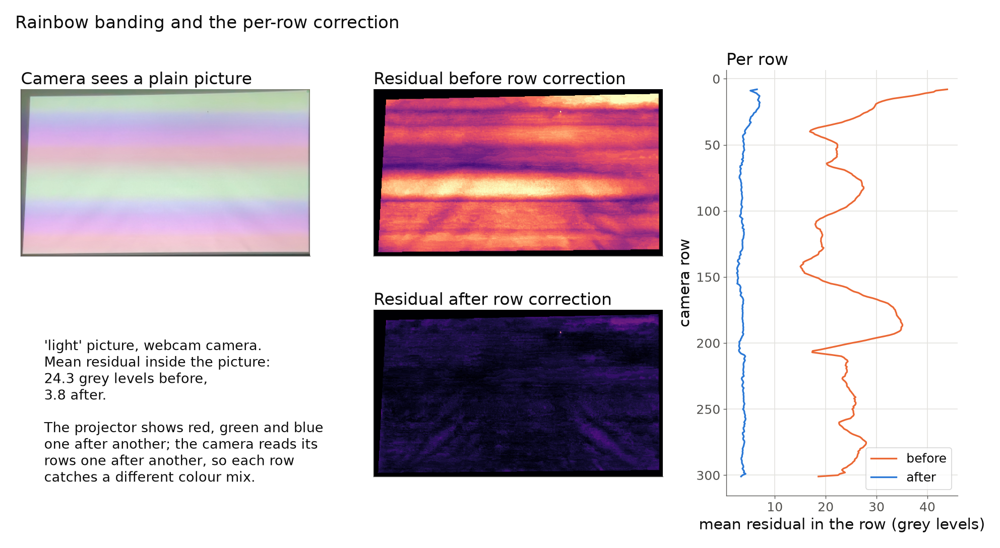

**Lecture.** Image arithmetic: the correction multiplies each row by its own gain. Solving for the gains is least squares, beyond the lectures.

**Main parameters.** `ROW_RIDGE` (how strongly each row is held at "no change"), `ROW_LIMIT` (largest change allowed, 30 %), `BAND_SLACK` (extra tolerance for saturated colours, which banding hits hardest). If the limit is too high, the correction can "explain away" a hand that crosses many rows.

### 4d. Compare with a tolerance (the residual)

**What it does.** For each pixel we take the smallest and the largest predicted value in its 5×5 neighbourhood, widen that range by a quarter of its size plus the banding slack, and measure how far the observed pixel is *outside* that range. Inside the range, the residual is 0. The largest of the three channels is kept.

**Why.** The homography is accurate to about a pixel or two, and the camera blurs and sharpens edges. At every edge of text or a drawing, a one-pixel shift looks like a large difference. Comparing against the local min..max forgives that.

**Lecture.** Image subtraction (`g = f − h`, the lecture's example of finding what changed) and spatial filtering: the local min and max are order-statistic (non-linear) spatial filters, computed with OpenCV's `erode` and `dilate` on the grey image.

**Main parameter.** The neighbourhood size (5×5). Larger forgives more misalignment but also hides thin fingers on busy content.

### 4e. When the screen itself is changing

**What it does.** Games move, buttons light up, and the app draws a cursor ring that follows your finger. The camera frame is about 0.2 s old, and that delay wanders by a few frames, so we cannot know exactly which screen picture the camera saw. The engine therefore takes every screenshot from 0.15 s before to 0.15 s after the expected moment. Where they differ, the allowed range for a pixel stretches from the darkest to the brightest value any of them predicts (`others` in `Predictor.residual`). A pixel inside that range is fine. A hand is usually outside it, so it is still found.

**Why.** Our first version simply ignored changed pixels. That blinded the engine exactly at the fingertip, because the cursor ring changes there all the time: in a simulated test the pointer wobbled by 70 px and never clicked. Our second version compared against only the two nearest screenshots, which broke as soon as the simulation was given a realistic 0.2 s display delay.

**A rule for the apps that follows from the physics.** A finger is invisible to the camera wherever the projector shows something dark, because it receives no light there. So nothing dark may be drawn at the fingertip: the cursor ring is bright (a dark outline cut the fingertip off from the hand), and the Board draws in blue by default (with black ink the pen trailed about 40 px behind the finger in simulation). Both cases are regression tests in `tests/test_simulated_rig.py`.

**Lecture.** Image subtraction, done against more than one reference image, with a pixel-wise minimum (image arithmetic).

### Why each step is there: the ablation ("alternative methods")

We switched the steps on one at a time and scored all 23 test pictures, 3 frames each, for both cameras (`eval/experiments.py`). Note that the predictor's tuning knobs were adjusted during development on part of this same dataset, so these offline numbers are on development data, not on an unseen test set. The live-rig results use newly generated hands. Variant (a) is the simplest alternative: plain subtraction of the warped screenshot after one global straight-line brightness fit (`camera = gain × screen + offset`). The first measure uses the real thresholds and morphology. The second is threshold-free: how many hand pixels are found if only 1 % of clean pixels may be flagged.

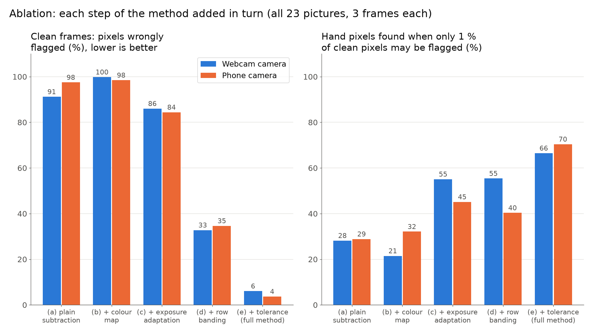

<!-- BEGIN ablation -->
| Variant | Webcam: clean pixels flagged | Webcam: clean frames with a false hand | Webcam: hand pixels found at 1 % false positives | Phone: clean pixels flagged | Phone: clean frames with a false hand | Phone: hand pixels found at 1 % false positives |
|---|---|---|---|---|---|---|
| (a) plain subtraction, global gain | 91.2 % | 96 % | 28 % | 97.5 % | 100 % | 29 % |
| (b) + colour map | 99.8 % | 100 % | 21 % | 98.5 % | 100 % | 32 % |
| (c) + exposure adaptation | 86.0 % | 91 % | 55 % | 84.4 % | 91 % | 45 % |
| (d) + row banding correction | 32.8 % | 43 % | 55 % | 34.6 % | 59 % | 40 % |
| (e) + neighbourhood tolerance (full) | 6.1 % | 30 % | 66 % | 3.7 % | 39 % | 70 % |
<!-- END ablation -->

How to read it: the colour map alone does not help, because the camera's exposure at test time differs from calibration time. It pays off once exposure adaptation is added. Row correction removes most of the remaining false pixels. The tolerance step removes the edge errors. Even the full method still flags a hand in some clean frames: these come almost entirely from photos and dark slides (section "What fails").

## 5. Threshold, morphology, connected components

**What it does** (`clean_mask` in `hands.py`):

1. **Hysteresis threshold.** Pixels with residual above `LOW = 8` are weak evidence. A blob is only kept if at least 20 % of its pixels are above `HIGH = 18` (strong evidence).
2. **Morphology.** An opening (3×3) removes single noisy pixels and thin lines left at edges. A closing (7×7) fills small holes inside the hand.
3. **Connected components.** Every separate blob gets a label. Blobs smaller than 0.15 % of the image are dropped.
4. **Thickness test.** A blob must be at least 7 pixels wide somewhere (`THICK`), tested with an erosion. An arm is wide; the leftovers along the coloured outlines of buttons are thin strips, and this removes them.
5. **Grouping.** Pieces closer than 17 pixels (`GAP`) count as one blob, and a blob is kept if it contains at least one piece that passed the tests above. Where the picture is dark, a hand or shadow leaves no trace, so an arm reaching across the dark outline of a button is cut in two; grouping puts it back together.
6. Thin parts attached to a kept blob (a finger the opening removed) are grown back, up to 12 pixels.

**Why.** A single threshold forces a bad choice: low enough to catch a faint hand also catches noise; high enough to ignore noise also cuts off the faint fingertip. Hysteresis uses the high threshold to decide *whether* a blob is real and the low one to decide *how big* it is.

**Lecture.** Piecewise-linear transformations: thresholding turns a grey image into a binary image. Opening and closing are neighbourhood operations on that binary image (a min filter then a max filter, and the other way round), so they build on spatial filtering.

**Main parameters.** `LOW` and `HIGH`. Lower thresholds find more of the hand but raise false alarms. The ROC curve and the sweep show where our choice sits. The engine also has a user **sensitivity** setting that divides both thresholds by one number between 0.4 and 2.5 (protocol command `sensitivity`); our tests use the default, 1.

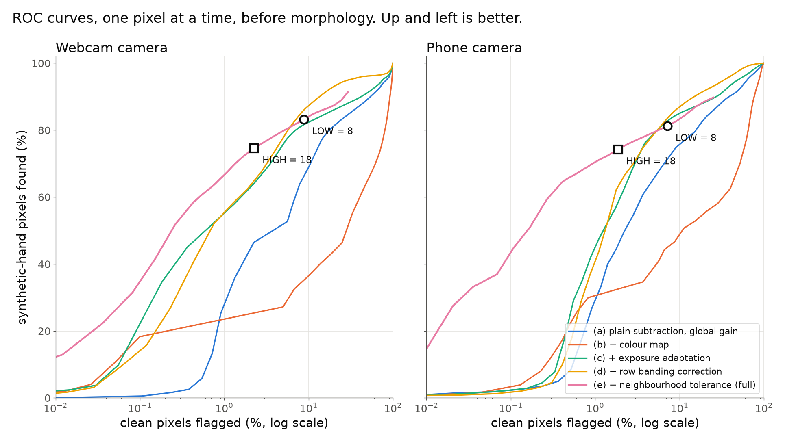

<!-- BEGIN thresholds -->
| Camera | Threshold (grey levels) | Clean pixels above it | Hand pixels above it |
|---|---|---|---|
| Webcam | LOW = 8 | 8.8 % | 83.2 % |
| Webcam | HIGH = 18 | 2.3 % | 74.6 % |
| Phone | LOW = 8 | 7.2 % | 81.2 % |
| Phone | HIGH = 18 | 1.9 % | 74.3 % |
<!-- END thresholds -->

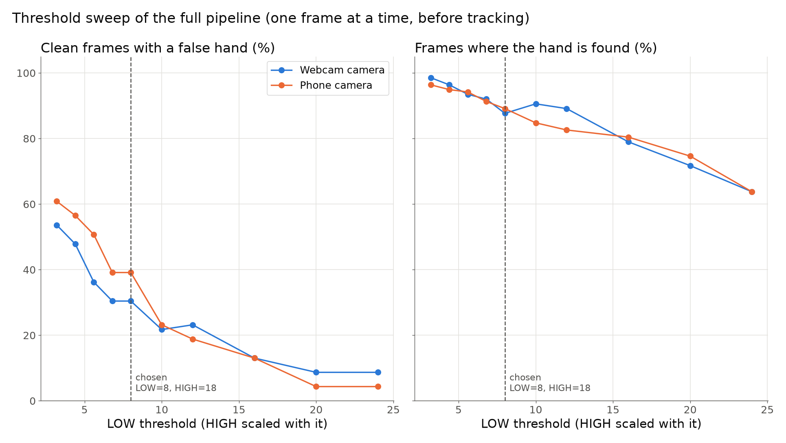

## 6. Fingertip

**What it does** (`find_tips` in `hands.py`). An arm always enters the picture from an edge. So a blob counts as a hand only if at least 5 of its pixels lie in a thin band, about 4 working pixels wide, along the edge of the projected area (the area minus its 9×9 erosion). The entry point is the mean of the blob's pixels in that band. The fingertip is the mean of the 1 % of blob pixels farthest from the entry point.

**Why.** It is simple, fast, and works for any hand shape that points away from the body. Islands in the middle of the screen (a flicker, a reflection) are ignored.

**Lecture.** Binary images and pixel distances (Euclidean distance between pixel coordinates). The rule itself is our own.

**Main parameter.** The edge band (set by the 9×9 erosion). If it is wider, false blobs near the edge count as arms; if narrower, an arm that enters at a slant may be missed.

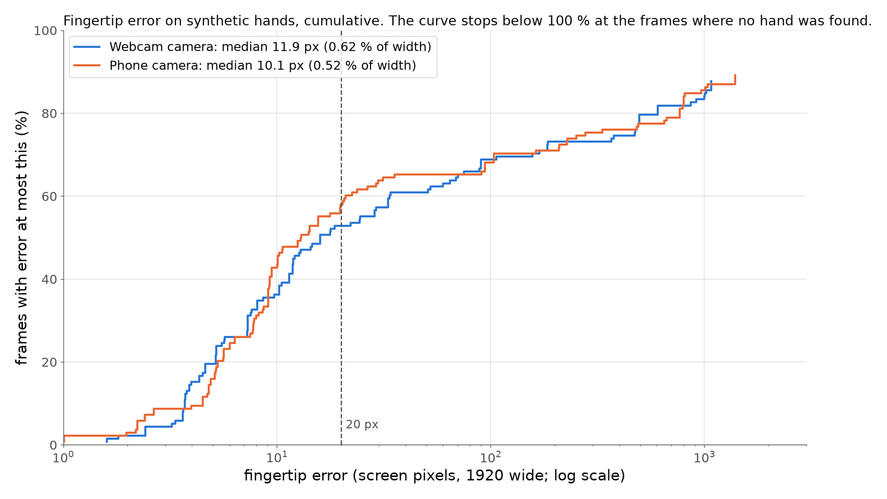

<!-- BEGIN fingertip -->
| Camera | Frames with a hand | Hand found | Median error (px) | Median (% of width) | 90th percentile (px) | Found tips within 20 px |
|---|---|---|---|---|---|---|
| Webcam | 138 | 88 % | 12.1 | 0.63 % | 622 | 58 % |
| Phone | 138 | 89 % | 10.1 | 0.52 % | 682 | 67 % |
<!-- END fingertip -->

**Two guards on the fingertip.** It is looked for only on parts of the blob at least 5 pixels wide (`SOLID`), and no further than 26 pixels (`FINGER`) from the hand's wide body. A thin leftover along a button's outline can touch the hand; without these guards it would drag the fingertip along the outline.

## 7. Hand pose with MediaPipe

**What it does.** MediaPipe Hands is a neural network from Google that finds 21 points (landmarks) on a hand. We do not run it on the whole frame. We cut a square around the fingertip, moved a little towards the arm, about a quarter of the picture's width across, enlarge it to 320×320, and run MediaPipe on that crop (`Landmarker` in `hands.py`). Simple rules on the landmarks give the pose: thumb tip near index tip = **pinch**, all four fingers stretched = **palm**, none stretched = **fist**, otherwise **point**.

**Why.** The classical pipeline finds *where* something is, but not *what* the hand is doing. Pinch is our click; an open palm is the eraser.

**Lecture.** Beyond the lectures (a learned model, a convolutional neural network). The crop is ordinary image cropping and resizing (sampling).

**Main parameter.** Crop size (`0.13 × picture width`, half-size) and confidence (0.3). A bigger crop gives more context but makes the hand smaller in the 320×320 input.

**What we can say so far.** On our synthetic hands MediaPipe almost never fires, which is expected: they are flat paintings, not hands. This does not tell us how well it works on real hands; that waits for the real-hand test.

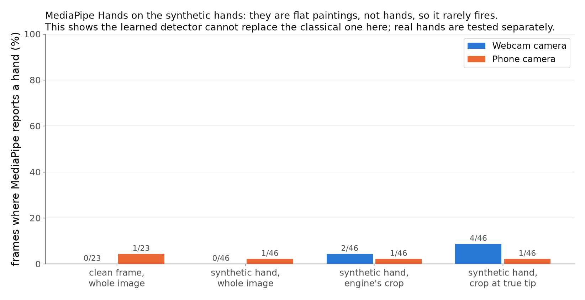

<!-- BEGIN mediapipe -->
| Input | Webcam: fired | Phone: fired |
|---|---|---|
| clean frame, whole image | 0 / 23 | 1 / 23 |
| synthetic hand, whole image | 0 / 46 | 1 / 46 |
| synthetic hand, engine's crop | 2 / 46 | 2 / 46 |
| synthetic hand, crop at the true tip | 3 / 46 | 1 / 46 |

Time per call on this laptop (median): Webcam: whole frame 13 ms, crop 13 ms; Phone: whole frame 13 ms, crop 13 ms.
<!-- END mediapipe -->

## 8. Tracking, clicks and swipes

**What it does** (`track.py`). Each hand gets a Kalman filter that tracks its position and speed. Each new fingertip measurement is blended with the filter's prediction, so jitter is smoothed. The filter also predicts 60 ms ahead (`LEAD`) to hide part of the camera delay. A new pointer is reported only after 3 detections in a row (`CONFIRM`), which removes one-frame flickers.

- **Click by dwell**: hold the pointing finger still (within 2.5 % of the screen width) for 0.8 s.
- **Click by pinch**: the pinch pose holds the button down.
- **Hold mode** (protocol command `dwell` set to `hold`): the first hold presses and stays pressed while the finger moves, the next hold releases. This lets you draw without pinching. The Board switches it on while the hand is over the drawing area and back to ordinary taps over its toolbar.
- **Swipe**: move 30 % of the screen width sideways within 0.5 s (used by the Slides app).

**Lecture.** Beyond the lectures (the Kalman filter is a state estimator from control theory).

**Main parameters.** `CONFIRM` (more = fewer false pointers but a slower start), `LEAD` (more = less lag but overshoot when the finger stops), `DWELL_TIME` (shorter = faster clicks but accidental ones).

## 9. Automatic keystone correction

**What it does** (`keystone.py`). A projector that is not square to the screen throws a lopsided picture. During calibration the projector shows white, and we look for the frame of the projection screen around it: we lift the dark surroundings with a gamma curve (`grey^0.35`), blur, walk outwards from the picture's edges, and stop at the first strong brightness change. A straight line is fitted through the stops on each side. The four lines give the screen frame. We then draw the picture pre-distorted, inside the largest upright 16:9 rectangle that fits on the wall.

**Why.** A straight picture looks right and keeps buttons where users expect them.

**Lecture.** The gamma lift is the power-law transformation `s = c·r^γ` with γ < 1, which brightens dark regions. The blur is a smoothing spatial filter. "Brightness change over 6 pixels" is a first-derivative edge detector, the idea behind sharpening filters. Line fitting and the rectangle search go beyond the lectures.

**Main parameter.** The edge strength (0.09 after the gamma lift). Too low stops at texture on the wall; too high misses a faint screen border, and the correction falls back to the camera's own view.

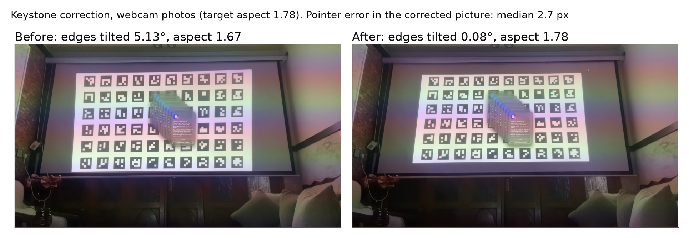

<!-- BEGIN keystone -->
|  | Edge tilt | Aspect ratio (target 1.78) | Markers found |
|---|---|---|---|
| Before | 5.30° | 1.666 | 53 |
| After | 0.11° | 1.778 | 53 |

Pointer error inside the corrected picture (synthetic shadow): median 3.1 px over 83 frames.
<!-- END keystone -->

## 10. Output

The engine sends pointer positions about 30 times a second to the web front end, which turns them into ordinary browser pointer events, so every app works with a mouse too (`docs/protocol.md`). In desktop mode the engine moves the operating system's mouse instead.

---

## What fails, and why

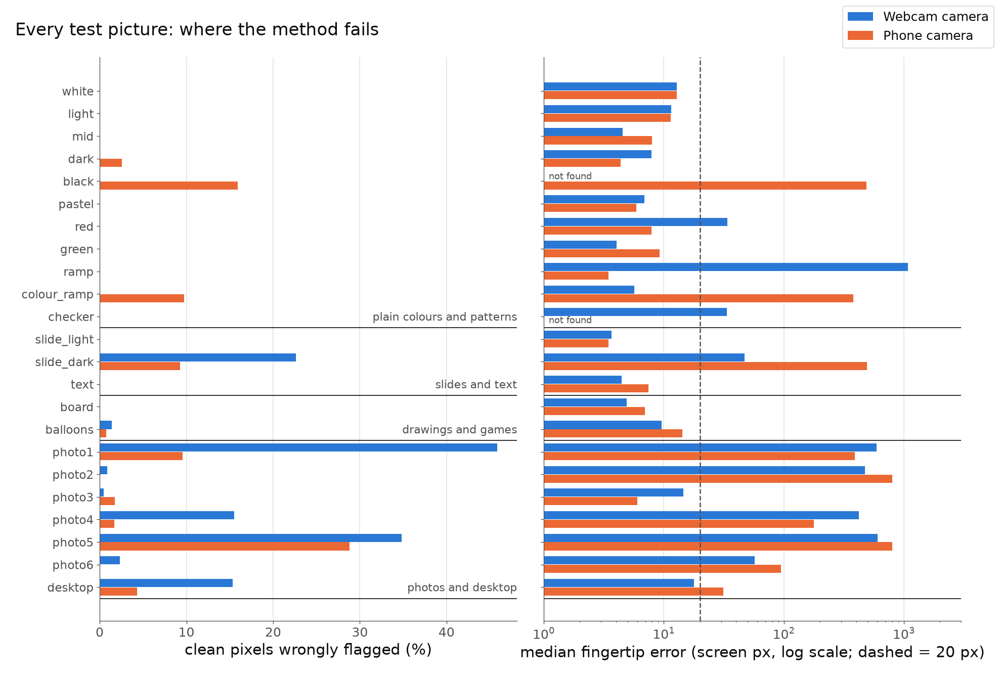

<!-- BEGIN per_class -->
| Content | Camera | Clean pixels flagged | Clean frames with a false hand | Shadow pixels found | Lit-hand pixels found | Median tip error |
|---|---|---|---|---|---|---|
| plain colours and patterns | Webcam | 0.0 % | 0 % | 91 % | 74 % | 10 px |
| plain colours and patterns | Phone | 2.6 % | 27 % | 85 % | 90 % | 9 px |
| slides and text | Webcam | 7.5 % | 33 % | 100 % | 90 % | 5 px |
| slides and text | Phone | 3.1 % | 33 % | 100 % | 96 % | 7 px |
| drawings and games | Webcam | 0.7 % | 0 % | 100 % | 100 % | 7 px |
| drawings and games | Phone | 0.4 % | 0 % | 100 % | 100 % | 10 px |
| photos and desktop | Webcam | 16.5 % | 86 % | 95 % | 75 % | 184 px |
| photos and desktop | Phone | 6.6 % | 71 % | 86 % | 64 % | 98 px |
<!-- END per_class -->

- **Photos and the desktop screenshot.** Fine detail (leaves, small icons) everywhere. In the failure figure below, the residual (panel 4) is high all over the textured areas, not only on the hand: at fine detail, small errors in position, blur and colour are larger than the 5×5 tolerance forgives. Clean frames then get false blobs. When a false blob joins the hand's blob, the "farthest point" lands in the wrong place, which is why the median tip error is large for this class.
- **Dark content.** A shadow on black is still black: there is no projected light to take away, so a hand on a black area is invisible to this method (the `black` picture). Dark slides also give false blobs; we have not isolated why.
- **Text.** Inside the hand, black text stays black (a dark pixel stays dark whether or not a hand is in front of it), so the hand's blob has holes along every text line (panel 4 of the figure at the top of this page). On the live rig, the dense `text` page breaks the blob up so much that the pointer is often missing or wrong.
- **Not tested yet:** real skin, a real 3-D shadow that falls apart from the hand, pinch on a real hand, and a person whose body blocks the camera's view.

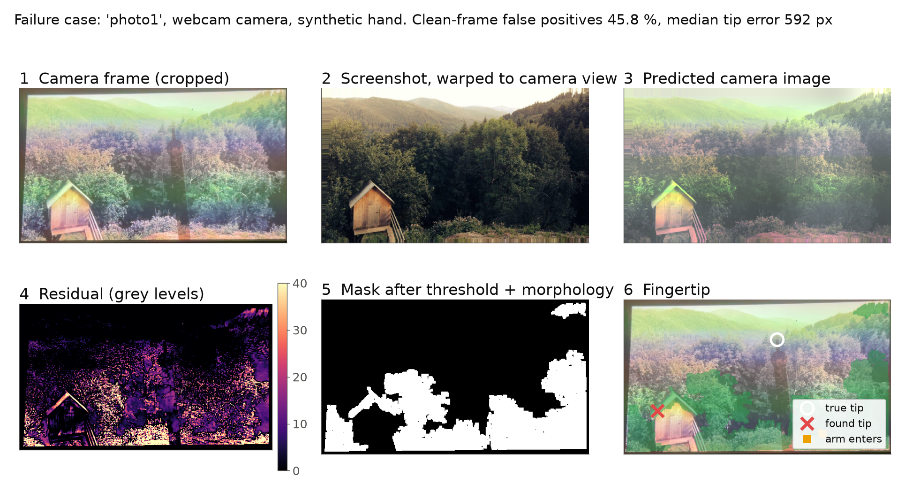

## Likely examiner questions

**Why not just run MediaPipe on the raw camera frame?**
Three reasons. (1) MediaPipe finds *hands*, not *touches*: it cannot tell a real hand from a hand that is part of the projected picture (a photo on a slide), while subtraction ignores everything the computer itself is showing. (2) The projector paints the picture onto the hand, so the hand has strange colours and low contrast; the model card warns that it was not tested in unusual conditions such as low light (reference [33]), and we expect projected light to be similarly unfamiliar. (3) In a full camera frame the hand is small; a crop around the fingertip makes it big. We measured that a crop is not faster (the model resizes its input anyway), so the reason is accuracy, not speed. On our synthetic hands MediaPipe almost never fires, but they are not real hands, so the fair comparison waits for the real-hand test.

**What fails and why?** See the section above: photos and busy screens (false blobs), dark content (a shadow on black is invisible), dense text (the hand's blob breaks up).

**Why predict the background instead of storing a photo of the empty screen?** The projected picture changes all the time (slides, games, drawing). A stored background would be wrong after every change. We know what is on the screen, so we predict what the camera should see.

**Why does the colour map need a polynomial? Isn't brightness enough?** The ablation shows it: a single straight-line brightness fit (variant a) flags most of the picture. Projector, screen and camera each bend colours, and they mix channels: the published models of a projector-camera pair use a full 3×3 colour-mixing matrix for this reason (Nayar et al., reference [1] in `docs/related-work.md`).

**What is a homography and why does it need at least 4 points?** It maps one plane to another in perspective. It has 8 unknowns, and each point pair gives 2 equations, so 4 points is the minimum. We use up to 240 and let RANSAC throw out bad ones.

**Why hysteresis and not one threshold?** One threshold must be both low (to find faint fingers) and high (to ignore noise). Hysteresis uses the high one to accept a blob and the low one to find its full extent.

**How did you choose the thresholds?** They were set during development. The ROC curve and the sweep on the recorded dataset check that choice: lower thresholds raise false alarms. The sweep also shows that on this dataset somewhat higher thresholds give fewer false alarms while still finding the hand about as often, so the choice is not optimal and is worth re-tuning once real-hand data exists.

**How do you know the user touches the wall and is not just pointing in the air?** We do not. One camera cannot measure depth. Clicks are made by holding still or by pinching. Telling touch from hover from the shadow is future work (see `docs/related-work.md`, section 2).

**How fast is it?** See the latency table in the report. The largest part is the camera and projector delay, not our processing.

**Is the accuracy good enough?** On synthetic hands with good content, the median fingertip error is a fraction of a percent of the screen width. Real-hand accuracy is not yet measured.
