# VisionTouch: a smart projector board from one camera

Digital Image Processing, course project report.
Team: [Member 1], [Member 2], [Member 3], [Member 4], [Member 5].

<!-- BEGIN generated -->
_Numbers generated 2026-11-20 00:56 from `runs/figures/results.json` and the rig reports by `eval/fill_report.py`._
<!-- END generated -->

## Summary

VisionTouch turns an ordinary projector and an ordinary camera (a laptop webcam or a phone) into a touch surface. The camera watches the projected picture. Because the computer knows what it is projecting, it can predict what the camera should see; whatever differs is a hand or its shadow. From that difference we find the fingertip, read the hand's pose, and send touches to our own apps or to the computer's mouse.

<!-- BEGIN headline -->
- **Webcam camera, recorded dataset (synthetic hands):** 6.1 % of clean pixels wrongly flagged (plain subtraction: 91.2 %); hand found in 88 % of frames; median fingertip error 11.9 px (0.62 % of the screen width).
- **Phone camera, recorded dataset (synthetic hands):** 3.7 % of clean pixels wrongly flagged (plain subtraction: 97.5 %); hand found in 89 % of frames; median fingertip error 10.1 px (0.52 % of the screen width).
- **Live rig, Webcam:** false-alarm frames on clean pictures at most 0 %; median pointer error within 20 px in 14 of 16 picture-and-hand cases; worst 722 px on `text`.
- **Live rig, Webcam, washed-out picture:** false-alarm frames on clean pictures at most 0 %; median pointer error within 20 px in 10 of 13 picture-and-hand cases; worst 280 px on `text`.
- **Live rig, Phone:** false-alarm frames on clean pictures at most 0 %; median pointer error within 20 px in 13 of 16 picture-and-hand cases; worst 1001 px on `text`.
- **Keystone (webcam):** edge tilt 5.1° before, 0.08° after; aspect 1.67 → 1.78 (target 1.78).
- **Real hands:** not yet measured.
<!-- END headline -->

**Limits of the evidence.** Every hand in these tests is synthetic: a hand shape painted into the projected picture, filmed through the real projector and cameras. This measures the vision pipeline under real light and real optics, but not real skin, real 3-D shadows, pinch detection on a real hand, or a body blocking the camera. The real-hand accuracy test has not been run yet (section 4.6).

---

## Phase 1. Problem, motivation and related work

### 1.1 Problem

Interactive whiteboards and touch projectors need dedicated hardware: a touch-sensitive board, an infrared light curtain, or a special pen. Many classrooms already have a projector and every laptop has a camera. The question of this project is: **can one ordinary colour camera, with image processing only, make any projected picture touchable?**

The hard part is that the camera does not see a quiet background. It sees the projected picture, which changes all the time, and the hand itself is lit by that picture. The classical "subtract a stored photo of the empty background" does not work when the background is a slide show or a game.

### 1.2 Goals (from the Phase 1 proposal)

- A pipeline in Python with OpenCV, NumPy and MediaPipe: capture → calibrate → detect → recognise → act.
- Detection by subtracting the known projected picture, and a comparison with a learned hand detector (MediaPipe).
- Gestures: point to move, pinch to click, open palm to erase, swipe to change slides.
- Apps: drawing board, games, slide control, and a mode that drives the computer's mouse.

### 1.3 Related work

Our literature review is in [`related-work.md`](related-work.md); reference numbers below are from that file.

- **Predicted-image subtraction.** Projector-camera systems have long predicted the camera image from the frame buffer through a model of the projector, surface and camera colours [1][2], and flagged pixels that disagree as shadows or hands [3][4]. Published models use a 3×3 colour-mixing matrix and per-channel response curves, calibrated from a few uniform pictures [1][2]. Castañeda-Garay et al. found that a *local* model detected 100 % of perturbations against 41 % for a global one [4]. No source we found handles a camera whose exposure changes by itself, which ordinary webcams and phones do; this is why we added per-frame exposure adaptation.
- **Hand versus shadow.** Plain subtraction finds the hand *and* its cast shadow, giving "high recall but poor precision" [6]. We treat hand and shadow together as one blob and find the fingertip from the blob's shape.
- **Touch from shadows.** PlayAnywhere [13] decides touch from the width of the finger's shadow, using an infrared camera that does not see the projected picture. With a visible-light camera this is open work [15][16].
- **Rolling-shutter banding.** Single-chip projectors show colours one after another; a camera that reads its rows one after another sees coloured bands [18]. We did not find a published correction for hand detection, so we wrote one (section 3.4).
- **MediaPipe Hands** [32] finds 21 hand landmarks. Its model card warns it was not tested in unusual conditions such as low light [33]; cropping around the hand helps when hands are small [34].
- **Calibration and keystone.** ArUco markers [37] give hundreds of labelled points in one frame; a homography maps the camera to the screen [40]. Automatic keystone correction finds the screen's frame and fits the largest upright rectangle inside the projected area [41][42].
- **Existing open-source projects** run a hand model on the raw camera image and decide "touch" by a button, a depth camera, or position alone; one reports about 100 ms of delay, and several warn about auto-exposure in dim rooms [45][46].
- **Latency.** Studies of direct touch suggest users notice delays far below what a webcam pipeline achieves [51][53], so hiding delay (prediction, local feedback) matters.

---

## Phase 2. Data and system design

### 2.1 The rig

A laser projector, driven at 1920×1080, on a pull-down screen. Two cameras watch the picture at the same time: the MacBook's webcam, below the projector's axis, and an Android phone 1.2 m to the side, streamed over USB. Both deliver 1920×1080 frames. The computer's display is mirrored to the projector.

### 2.2 The self-recorded dataset

We recorded our own dataset on the rig (`eval/capture_dataset.py`, stored in `runs/ds1` and `runs/ds1b`).

- **23 test pictures** (`eval/content.py`): 11 plain colours and test patterns (white, light, mid grey, dark, black, pastel, red, green, a grey ramp, a colour ramp, a checkerboard); 3 slides and text pages (a light slide, a dark slide, a page of dense text); 2 drawings and games (a drawing board, balloons); 7 photos and desktop (six photographs and a desktop screenshot).
- **Three versions of each:** clean, with a synthetic **shadow** (the hand area painted black: no projector light) and with a synthetic **lit hand** (the hand area multiplied by a skin tint, as the projected picture would look reflected from skin). The hand is a forearm, palm and pointing finger at a random position, entering from the bottom, left or right. Its ground-truth mask and fingertip position are saved.
- **Three frames per camera** of every version: 69 clean frames and 138 hand frames per camera.
- **Calibration captures** (`runs/ds1b`): the marker grid and six colour mosaics, photographed by both cameras.

When scoring, the predictor is always told the *clean* picture, just as the real engine would be: it does not know about the hand.

The predictor's tuning knobs were adjusted during development on part of `ds1`, so offline results are on development data, not on an unseen test set. The live-rig tests (section 4.4) use newly drawn hands.

### 2.3 Pipeline

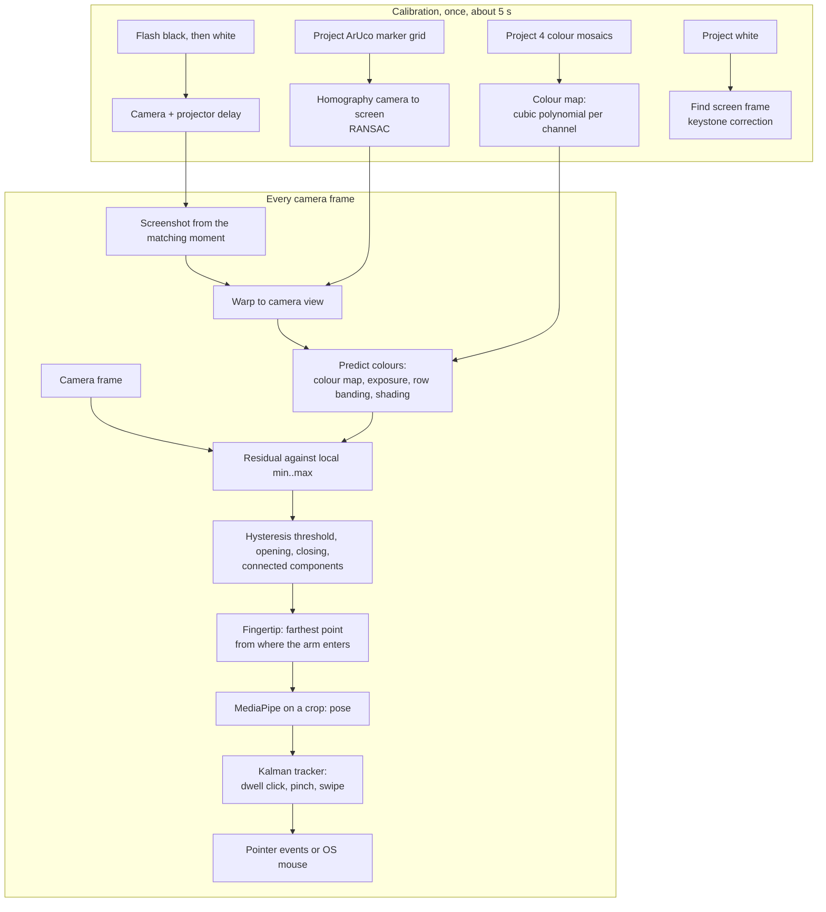

The engine is Python (`visiontouch/`: OpenCV, NumPy, MediaPipe). The projected apps are a web page (`web/`) that receives pointers over a WebSocket (`docs/protocol.md`).

---

## Phase 3. Implementation, with intermediate outputs

Each stage, its lecture topic and its main parameter are explained in [`how-it-works.md`](how-it-works.md). Here we show the intermediate images.

### 3.1 From camera frame to fingertip

The six panels are: the camera frame cropped to the projected area; the screenshot warped into the camera's view; the predicted camera image; the residual; the mask after thresholding and morphology; and the fingertip (white circle: truth, red cross: found, orange square: where the arm enters).

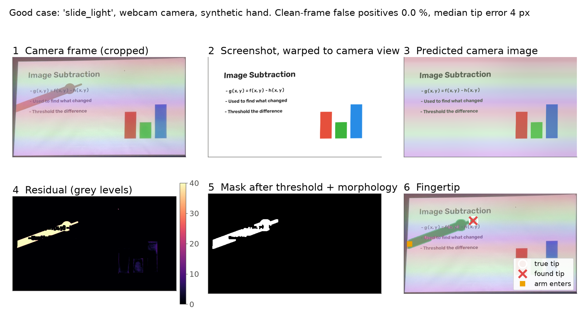

### 3.2 Geometric calibration

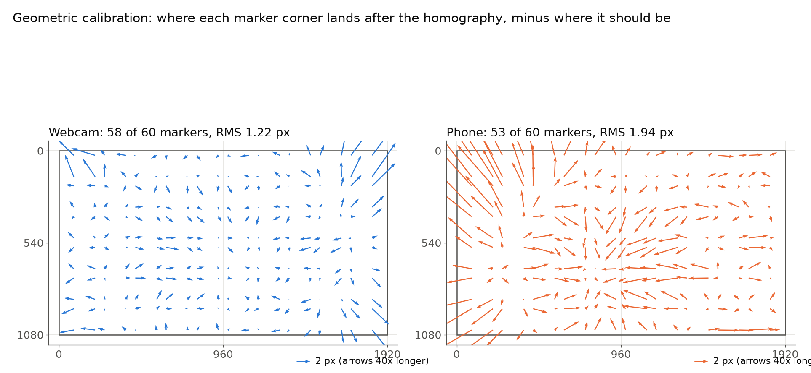

<!-- BEGIN calibration -->
| Camera | Markers found | RMS error (px) | Median corner error (px) | Worst corner (px) | RMS over 3 photos (px) | Same H on the other session's photo (px) |
|---|---|---|---|---|---|---|
| Webcam | 58 / 60 | 1.22 | 0.95 | 7.3 | 1.23, 1.22, 1.30 | 1.59 |
| Phone | 53 / 60 | 1.94 | 1.82 | 12.3 | 1.79, 1.94, 1.88 | 3.07 |
<!-- END calibration -->

The phone, which views the screen at a steeper angle and from farther away, finds fewer markers and has a larger error, mostly in one corner of the picture. The last column re-uses the homography on the marker photo of the other recording session; it stays close to the fitted error, so the cameras barely moved between sessions.

### 3.3 Colour prediction and exposure

The colour map is a cubic polynomial (20 terms per camera channel) fitted on the colour mosaics. Every frame, a 3×3 colour matrix plus offset moves it to the camera's current exposure. Section 4.1 shows what each part contributes.

### 3.4 Rainbow banding

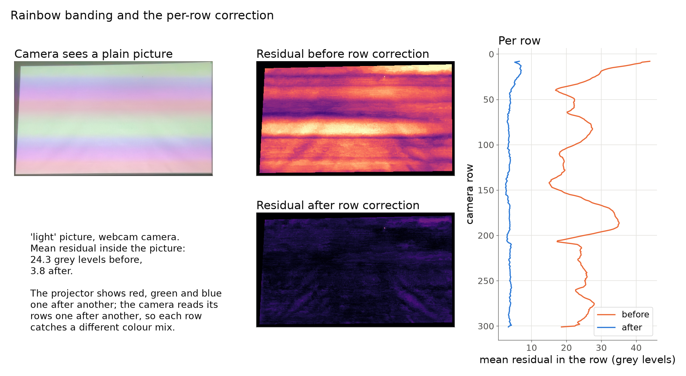

### 3.5 Thresholds and morphology

Hysteresis thresholds `LOW = 8` and `HIGH = 18` grey levels; opening 3×3, closing 7×7; blobs below 0.15 % of the image dropped; a blob must touch the edge of the picture to count as an arm.

### 3.6 Keystone correction

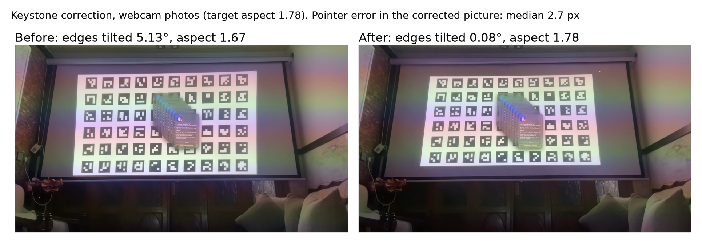

<!-- BEGIN keystone -->
|  | Edge tilt | Aspect ratio (target 1.78) | Markers found |
|---|---|---|---|
| Before | 5.11° | 1.668 | 58 |
| After | 0.08° | 1.777 | 59 |

Pointer error inside the corrected picture (synthetic shadow): median 5.1 px over 93 frames.
<!-- END keystone -->

---

## Phase 4. Evaluation

All numbers below are produced by `eval/experiments.py` (offline, on the dataset) and by the rig tests in `eval/live_test.py`, `eval/idle_test.py` and `eval/keystone_test.py`. They are copied into this report by `eval/fill_report.py`.

**Measures.** *Clean pixels flagged*: on clean frames, the share of pixels inside the picture that the mask marks (should be 0). *Clean frames with a false hand*: the share of clean frames where at least one arm-shaped blob is found. *Hand pixels found* (recall): the share of ground-truth hand pixels the mask covers. *Hand found*: the share of hand frames where a blob overlapping the true hand is found. *Fingertip error*: distance in screen pixels (screen 1920 wide) between the true tip and the tip of that blob.

### 4.1 Alternative methods: ablation

Each step of the method is switched on in turn. Variant (a) is plain subtraction after one global brightness fit; (e) is the full method.

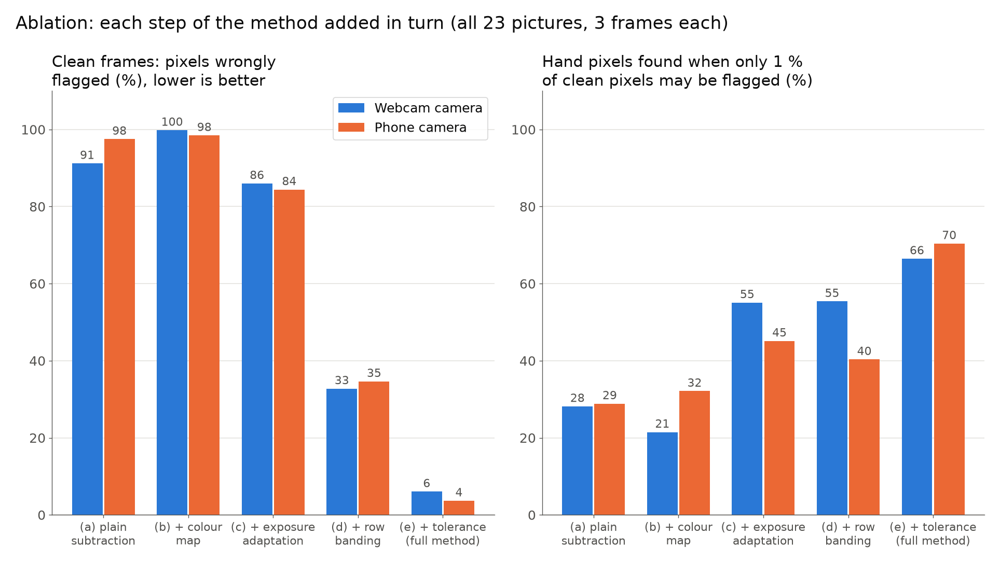

<!-- BEGIN ablation -->
| Variant | Webcam: clean pixels flagged | Webcam: clean frames with a false hand | Webcam: hand pixels found at 1 % false positives | Phone: clean pixels flagged | Phone: clean frames with a false hand | Phone: hand pixels found at 1 % false positives |
|---|---|---|---|---|---|---|
| (a) plain subtraction, global gain | 91.2 % | 96 % | 28 % | 97.5 % | 100 % | 29 % |
| (b) + colour map | 99.8 % | 100 % | 21 % | 98.5 % | 100 % | 32 % |
| (c) + exposure adaptation | 86.0 % | 91 % | 55 % | 84.4 % | 91 % | 45 % |
| (d) + row banding correction | 32.8 % | 43 % | 55 % | 34.6 % | 59 % | 40 % |
| (e) + neighbourhood tolerance (full) | 6.1 % | 30 % | 66 % | 3.7 % | 39 % | 70 % |
<!-- END ablation -->

The colour map alone does not help, because the camera's exposure at test time differs from calibration time; it pays off once exposure adaptation is added. Row correction removes most of the false pixels that remain, and the neighbourhood tolerance removes the edge errors.

### 4.2 Parameter test: thresholds

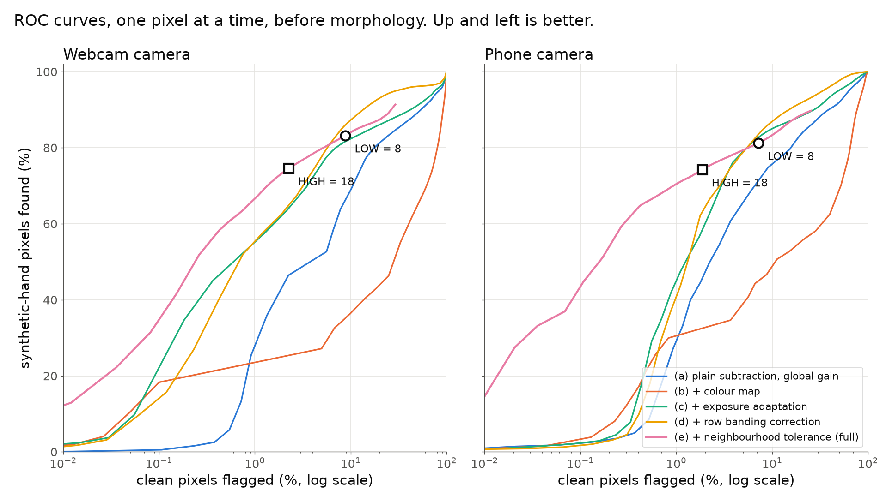

<!-- BEGIN thresholds -->
| Camera | Threshold (grey levels) | Clean pixels above it | Hand pixels above it |
|---|---|---|---|
| Webcam | LOW = 8 | 8.8 % | 83.2 % |
| Webcam | HIGH = 18 | 2.3 % | 74.6 % |
| Phone | LOW = 8 | 7.2 % | 81.2 % |
| Phone | HIGH = 18 | 1.9 % | 74.3 % |
<!-- END thresholds -->

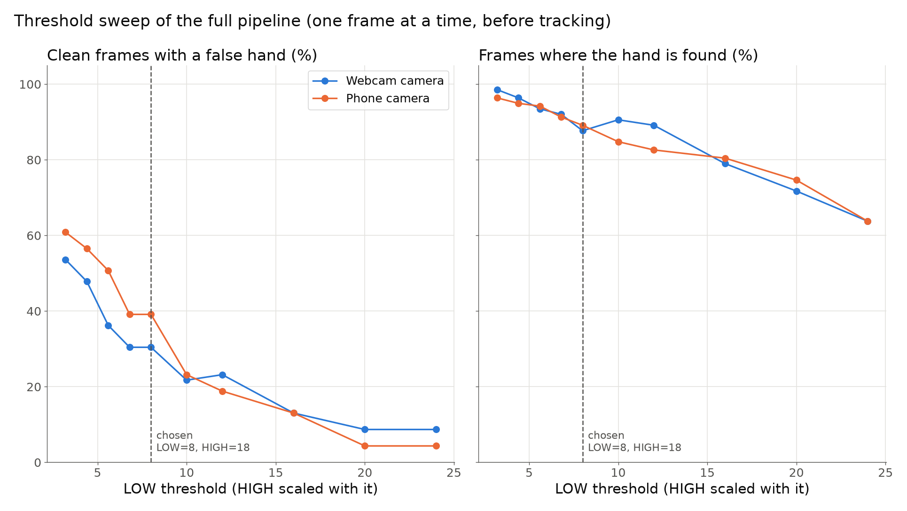

<details><summary>Sweep table</summary>

<!-- BEGIN sweep -->
| Camera | LOW / HIGH | Clean pixels flagged | Clean frames with a false hand | Hand pixels found | Hand found |
|---|---|---|---|---|---|
| Webcam | 3.2 / 7.2 | 20.4 % | 54 % | 94 % | 99 % |
| Webcam | 4.4 / 9.9 | 14.6 % | 48 % | 93 % | 96 % |
| Webcam | 5.6 / 12.6 | 11.4 % | 36 % | 90 % | 92 % |
| Webcam | 6.8 / 15.3 | 7.8 % | 30 % | 88 % | 90 % |
| Webcam | 8.0 / 18.0 (chosen) | 6.1 % | 30 % | 86 % | 88 % |
| Webcam | 10.0 / 22.5 | 3.9 % | 22 % | 87 % | 91 % |
| Webcam | 12.0 / 27.0 | 3.0 % | 23 % | 83 % | 89 % |
| Webcam | 16.0 / 36.0 | 1.6 % | 13 % | 76 % | 79 % |
| Webcam | 20.0 / 45.0 | 1.1 % | 9 % | 67 % | 72 % |
| Webcam | 24.0 / 54.0 | 0.7 % | 9 % | 59 % | 64 % |
| Phone | 3.2 / 7.2 | 17.8 % | 61 % | 94 % | 96 % |
| Phone | 4.4 / 9.9 | 11.9 % | 57 % | 92 % | 95 % |
| Phone | 5.6 / 12.6 | 8.4 % | 51 % | 90 % | 94 % |
| Phone | 6.8 / 15.3 | 4.7 % | 39 % | 87 % | 91 % |
| Phone | 8.0 / 18.0 (chosen) | 3.7 % | 39 % | 86 % | 89 % |
| Phone | 10.0 / 22.5 | 1.8 % | 23 % | 83 % | 85 % |
| Phone | 12.0 / 27.0 | 1.5 % | 19 % | 80 % | 82 % |
| Phone | 16.0 / 36.0 | 0.9 % | 13 % | 77 % | 79 % |
| Phone | 20.0 / 45.0 | 0.4 % | 4 % | 72 % | 75 % |
| Phone | 24.0 / 54.0 | 0.1 % | 4 % | 64 % | 64 % |
<!-- END sweep -->

</details>

The offline counts are per single frame, before the tracker's three-frame confirmation. On this dataset, somewhat higher thresholds than the chosen ones give fewer false alarms while finding the hand about as often; the thresholds should be re-tuned once real-hand data exists.

### 4.3 Results by content, and failure cases

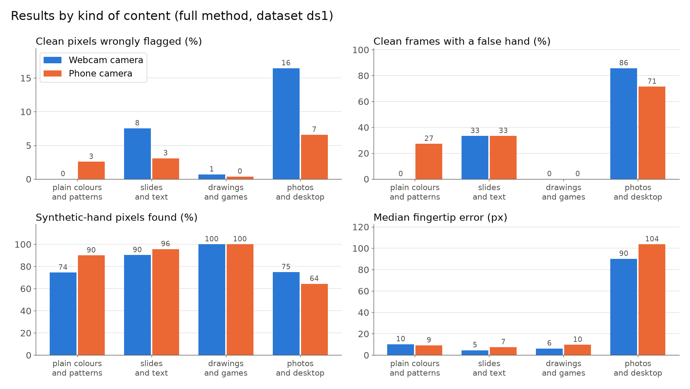

<!-- BEGIN per_class -->
| Content | Camera | Clean pixels flagged | Clean frames with a false hand | Shadow pixels found | Lit-hand pixels found | Median tip error |
|---|---|---|---|---|---|---|
| plain colours and patterns | Webcam | 0.0 % | 0 % | 91 % | 74 % | 10 px |
| plain colours and patterns | Phone | 2.6 % | 27 % | 85 % | 90 % | 9 px |
| slides and text | Webcam | 7.5 % | 33 % | 100 % | 90 % | 5 px |
| slides and text | Phone | 3.1 % | 33 % | 100 % | 96 % | 7 px |
| drawings and games | Webcam | 0.7 % | 0 % | 100 % | 100 % | 6 px |
| drawings and games | Phone | 0.4 % | 0 % | 100 % | 100 % | 10 px |
| photos and desktop | Webcam | 16.5 % | 86 % | 95 % | 75 % | 90 px |
| photos and desktop | Phone | 6.6 % | 71 % | 86 % | 64 % | 104 px |
<!-- END per_class -->

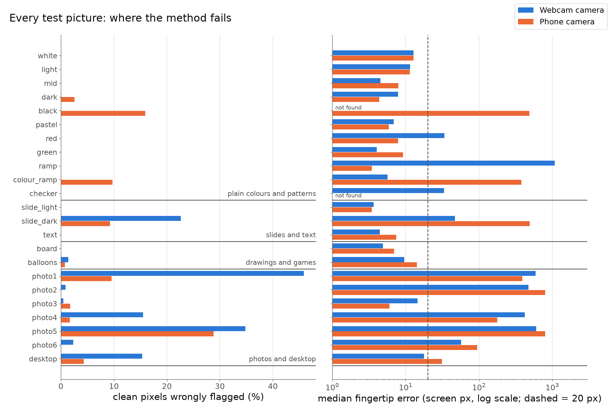

<details><summary>Every picture, sorted by clean-frame false positives</summary>

<!-- BEGIN per_picture -->
| Picture | Class | Webcam: clean pixels flagged | Webcam: hand found | Webcam: median tip error | Phone: clean pixels flagged | Phone: hand found | Phone: median tip error |
|---|---|---|---|---|---|---|---|
| photo1 | photos and desktop | 45.8 % | 100 % | 592 px | 9.6 % | 100 % | 389 px |
| photo5 | photos and desktop | 34.8 % | 100 % | 604 px | 28.8 % | 100 % | 800 px |
| slide_dark | slides and text | 22.6 % | 100 % | 47 px | 9.3 % | 100 % | 493 px |
| black | plain colours and patterns | 0.0 % | 0 % | – | 15.9 % | 50 % | 490 px |
| photo4 | photos and desktop | 15.5 % | 100 % | 420 px | 1.7 % | 100 % | 178 px |
| desktop | photos and desktop | 15.3 % | 50 % | 18 px | 4.3 % | 50 % | 31 px |
| colour_ramp | plain colours and patterns | 0.0 % | 67 % | 6 px | 9.7 % | 100 % | 379 px |
| dark | plain colours and patterns | 0.0 % | 100 % | 8 px | 2.6 % | 100 % | 4 px |
| photo6 | photos and desktop | 2.4 % | 100 % | 57 px | 0.0 % | 100 % | 94 px |
| photo3 | photos and desktop | 0.5 % | 100 % | 15 px | 1.7 % | 100 % | 6 px |
| balloons | drawings and games | 1.4 % | 100 % | 10 px | 0.8 % | 100 % | 14 px |
| photo2 | photos and desktop | 0.9 % | 50 % | 472 px | 0.0 % | 50 % | 800 px |
| board | drawings and games | 0.0 % | 100 % | 5 px | 0.0 % | 100 % | 7 px |
| checker | plain colours and patterns | 0.0 % | 100 % | 33 px | 0.0 % | 0 % | – |
| green | plain colours and patterns | 0.0 % | 100 % | 4 px | 0.0 % | 100 % | 9 px |
| light | plain colours and patterns | 0.0 % | 100 % | 12 px | 0.0 % | 100 % | 11 px |
| mid | plain colours and patterns | 0.0 % | 100 % | 5 px | 0.0 % | 100 % | 8 px |
| pastel | plain colours and patterns | 0.0 % | 100 % | 7 px | 0.0 % | 100 % | 6 px |
| ramp | plain colours and patterns | 0.0 % | 50 % | 1077 px | 0.0 % | 100 % | 3 px |
| red | plain colours and patterns | 0.0 % | 100 % | 34 px | 0.0 % | 100 % | 8 px |
| slide_light | slides and text | 0.0 % | 100 % | 4 px | 0.0 % | 100 % | 3 px |
| text | slides and text | 0.0 % | 100 % | 4 px | 0.0 % | 100 % | 7 px |
| white | plain colours and patterns | 0.0 % | 100 % | 13 px | 0.0 % | 100 % | 13 px |
<!-- END per_picture -->

</details>

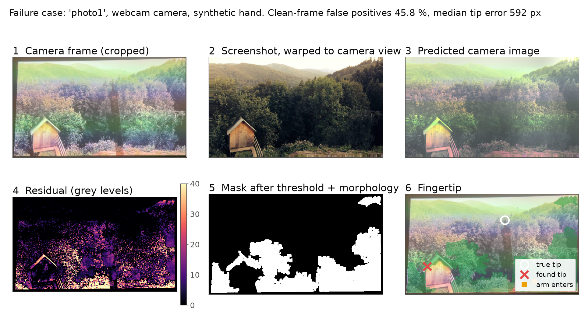

**Failure cases.**

- **Photos and the desktop screenshot** are the hardest class. The residual is high over all fine texture, not just on the hand (panel 4 above), so clean frames get false blobs; when one joins the hand's blob, the fingertip lands far away.
- **Black and dark content.** A shadow on black removes no light, so the hand is invisible on `black` for both cameras. Dark slides also produce false blobs.
- **Text.** Black text inside the hand stays black, so the hand's blob has holes along each line of text. On the live rig the dense text page gave the worst results of all pictures (table in 4.4).

### 4.4 Live rig

The engine calibrates itself, then the test projects each picture. First the clean picture with real screen capture, to count false alarms. Then synthetic shadows and lit hands at three random places, while the engine is told that the screen shows the clean picture. The pointer the engine reports (after tracking) is compared with the known fingertip.

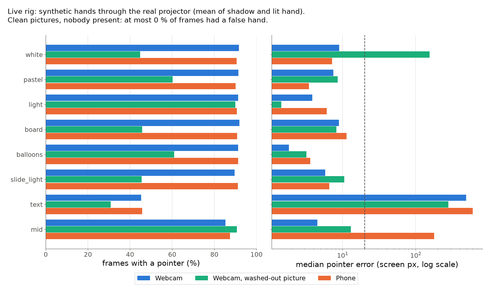

<!-- BEGIN live -->
| Camera | Picture | Clean: frames with a false hand | Shadow: frames with a pointer, median error | Lit hand: same |
|---|---|---|---|---|
| Webcam | white | 0 % | 91 %, 6 px | 92 %, 10 px |
| Webcam | pastel | 0 % | 90 %, 1 px | 91 %, 7 px |
| Webcam | light | 0 % | 91 %, 3 px | 91 %, 3 px |
| Webcam | board | 0 % | 90 %, 7 px | 90 %, 9 px |
| Webcam | balloons | 0 % | 90 %, 2 px | 91 %, 4 px |
| Webcam | slide_light | 0 % | 91 %, 4 px | 89 %, 7 px |
| Webcam | text | 0 % | 61 %, 108 px | 29 %, 722 px |
| Webcam | mid | 0 % | 90 %, 15 px | 90 %, 7 px |
| Webcam, washed-out picture | white | 0 % | 90 %, 154 px | 0 %, – |
| Webcam, washed-out picture | pastel | 0 % | 90 %, 2 px | 30 %, 15 px |
| Webcam, washed-out picture | light | 0 % | 91 %, 1 px | 89 %, 2 px |
| Webcam, washed-out picture | board | 0 % | 61 %, 6 px | 31 %, 10 px |
| Webcam, washed-out picture | balloons | 0 % | 91 %, 2 px | 31 %, 4 px |
| Webcam, washed-out picture | slide_light | 0 % | 91 %, 11 px | 0 %, – |
| Webcam, washed-out picture | text | 0 % | 62 %, 280 px | 0 %, – |
| Webcam, washed-out picture | mid | 0 % | 90 %, 23 px | 92 %, 3 px |
| Phone | white | 0 % | 90 %, 5 px | 91 %, 9 px |
| Phone | pastel | 0 % | 90 %, 3 px | 90 %, 4 px |
| Phone | light | 0 % | 91 %, 6 px | 90 %, 6 px |
| Phone | board | 0 % | 91 %, 12 px | 90 %, 11 px |
| Phone | balloons | 0 % | 91 %, 4 px | 91 %, 3 px |
| Phone | slide_light | 0 % | 91 %, 4 px | 91 %, 9 px |
| Phone | text | 0 % | 61 %, 207 px | 31 %, 1001 px |
| Phone | mid | 0 % | 84 %, 354 px | 91 %, 3 px |
<!-- END live -->

A second false-alarm test opened every app with nobody in front of the screen:

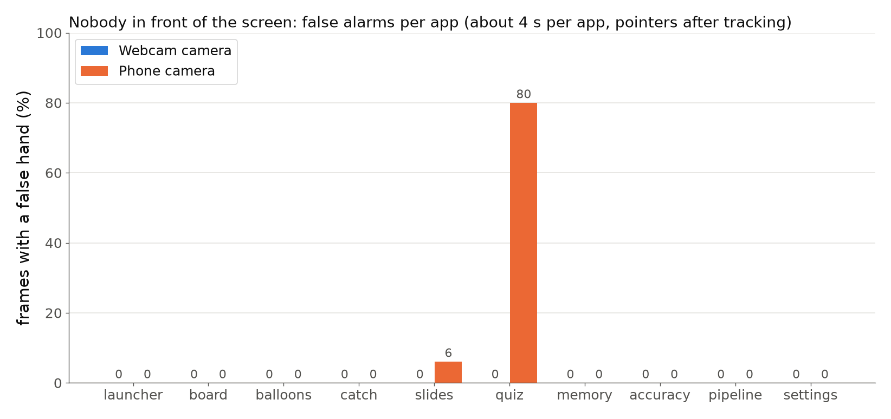

<!-- BEGIN idle -->
| App | Webcam: false-hand frames | Phone: false-hand frames |
|---|---|---|
| launcher | 0 / 121 | 0 / 116 |
| board | 0 / 121 | 0 / 114 |
| balloons | 0 / 121 | 0 / 118 |
| catch | 0 / 121 | 0 / 113 |
| slides | 0 / 121 | 7 / 115 |
| quiz | 0 / 121 | 44 / 55 |
| memory | 0 / 121 | 0 / 121 |
| accuracy | 0 / 121 | 0 / 119 |
| pipeline | 0 / 99 | 0 / 88 |
| settings | 0 / 121 | 0 / 119 |
<!-- END idle -->

### 4.5 Speed

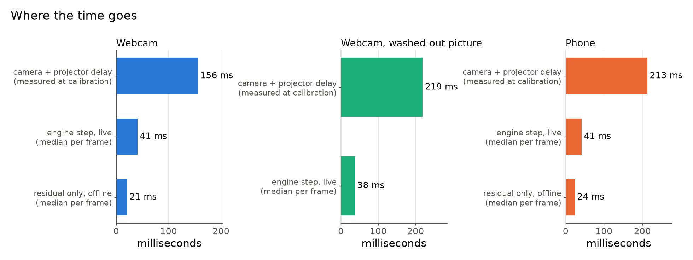

<!-- BEGIN latency -->
| Camera | Camera + projector delay (calibration) | Engine step, live (median) | Residual only, offline (median) |
|---|---|---|---|
| Webcam | 156 ms | 41 ms | 21 ms |
| Webcam, washed-out picture | 219 ms | 38 ms | – |
| Phone | 213 ms | 41 ms | 24 ms |
<!-- END latency -->

The largest share of the delay is the camera and projector, measured at calibration by flashing the screen and timing when the change appears in the screenshots and in the camera. The tracker predicts 60 ms ahead to hide part of it.

### 4.6 Fingertip accuracy

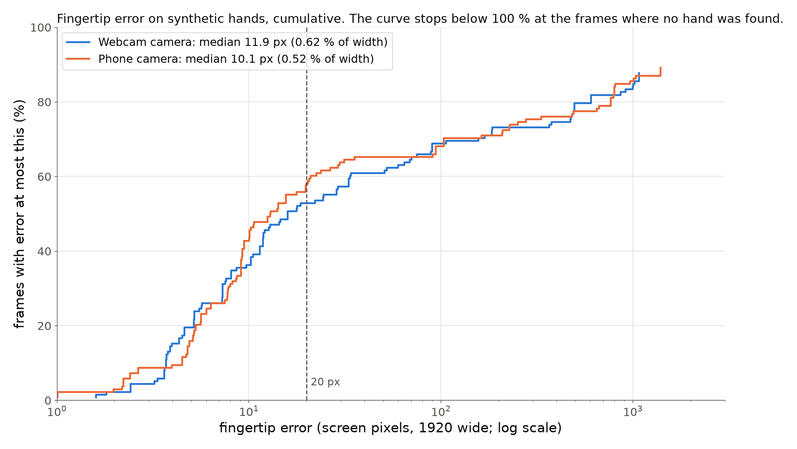

<!-- BEGIN fingertip -->
| Camera | Frames with a hand | Hand found | Median error (px) | Median (% of width) | 90th percentile (px) | Found tips within 20 px |
|---|---|---|---|---|---|---|
| Webcam | 138 | 88 % | 11.9 | 0.62 % | 496 | 60 % |
| Phone | 138 | 89 % | 10.1 | 0.52 % | 767 | 65 % |
<!-- END fingertip -->

**Real hands (Accuracy app):**

<!-- BEGIN real_hands -->
**Not yet measured.** The Accuracy app writes every tap to `~/.visiontouch/log.jsonl`; run `python -m eval.fill_report` after a session and this table fills in.
<!-- END real_hands -->

### 4.7 Classical versus learned

We ran MediaPipe Hands on the synthetic-hand frames: on the whole camera frame, on the crop the engine would use, and on a crop centred on the true fingertip.

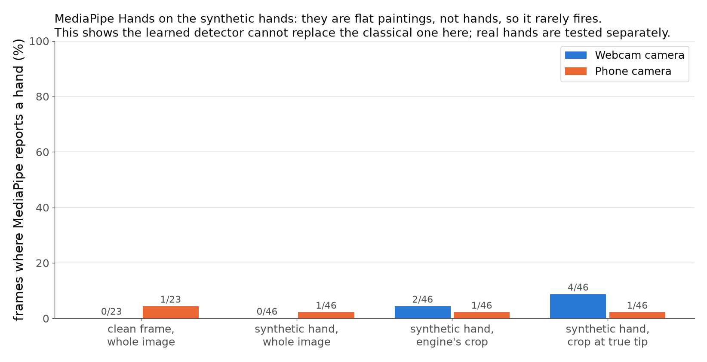

<!-- BEGIN mediapipe -->
| Input | Webcam: fired | Phone: fired |
|---|---|---|
| clean frame, whole image | 0 / 23 | 1 / 23 |
| synthetic hand, whole image | 0 / 46 | 1 / 46 |
| synthetic hand, engine's crop | 2 / 46 | 1 / 46 |
| synthetic hand, crop at the true tip | 4 / 46 | 1 / 46 |

Time per call on this laptop (median): Webcam: whole frame 14 ms, crop 14 ms; Phone: whole frame 14 ms, crop 14 ms.
<!-- END mediapipe -->

MediaPipe almost never fires on the synthetic hands, which is expected: they are flat paintings without fingers' shading or knuckles. This shows only that the learned detector cannot replace the classical one *on this test*. A fair comparison needs real hands and will be done with the Accuracy app. Two points do not depend on that test: the classical pipeline ignores anything that is part of the projected picture (a photo of a hand on a slide), and MediaPipe is needed anyway for the pose (pinch, palm), which the classical pipeline cannot read.

### 4.8 Strengths and weaknesses

**Strengths.**

- No special hardware: any projector, any webcam or phone.
- Works in front of changing content, because it predicts the background from the screenshot instead of storing it.
- Robust to the camera changing its exposure, and to the rainbow banding of single-chip projectors (section 4.1).
- On plain colours, drawings, games and light slides: few false pixels and small median fingertip errors (table in 4.3).
- Calibration, delay measurement and keystone correction are automatic and take a few seconds.

**Weaknesses.**

- Photos, busy desktops and dark content give false blobs and wrong fingertips.
- No true touch sensing: one camera cannot measure depth, so clicks use dwell or pinch.
- The camera and projector delay is large compared with what users notice on direct touch [51][53].
- Not yet tested with real hands.
- One hand pose model (MediaPipe) is a black box we did not train or evaluate on our setting.

---

## 5. Future work

1. **Real-hand test** with the Accuracy app, several users, both cameras; then re-tune `LOW` and `HIGH` on that data.
2. **Touch versus hover** from the finger's shadow, as PlayAnywhere does with infrared [13], adapted to visible light.
3. **Separate hand from shadow** using colour: a shadow darkens all channels equally, skin does not (an untested idea in `related-work.md`, section 1).
4. **Busy content:** a larger tolerance only where the screenshot has fine texture, or ignoring areas the predictor cannot explain on clean frames.
5. **Lower delay:** lock the camera's exposure where possible and use a faster camera mode.

## Reproducing the results

```
uv sync --group docs
uv run python -m eval.experiments      # about two minutes, writes runs/figures/results.json
uv run python -m eval.figures          # writes runs/figures/*.png and docs/figures/*.png
uv run python -m eval.fill_report      # refreshes the tables in this report
```

The rig tests (`eval/live_test.py`, `eval/idle_test.py`, `eval/keystone_test.py`) need the projector and camera and open a full-screen window.
